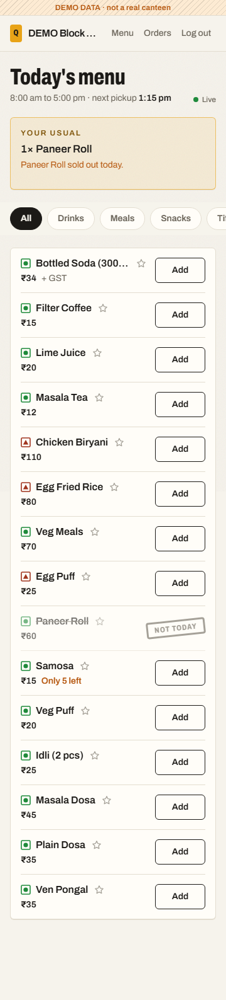
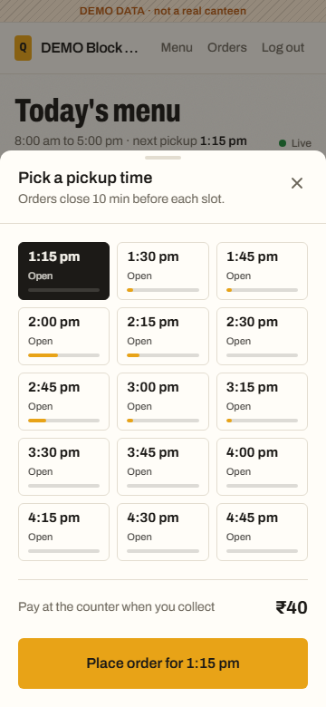
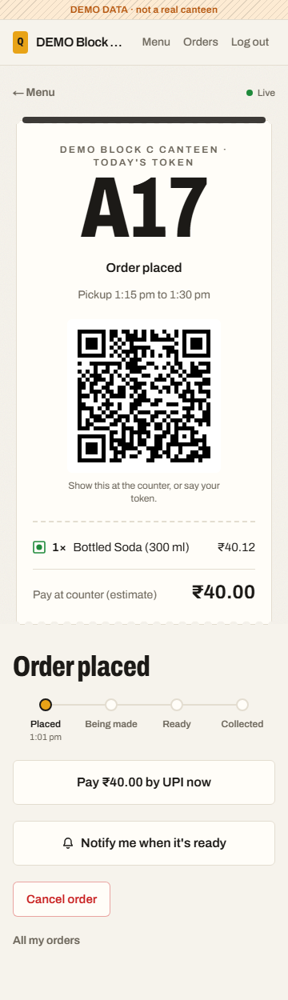
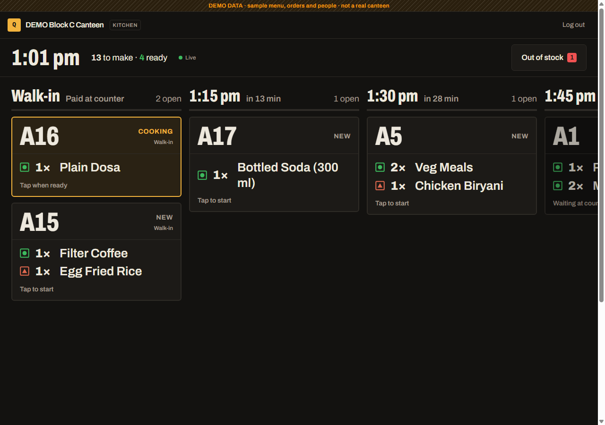
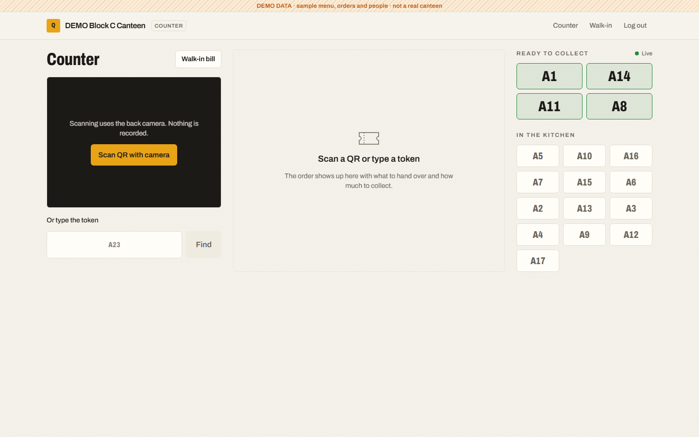
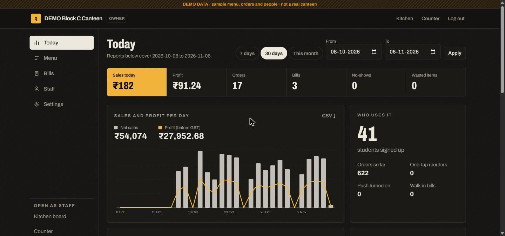
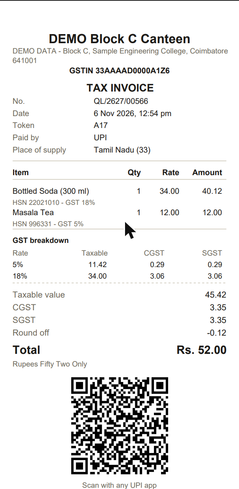
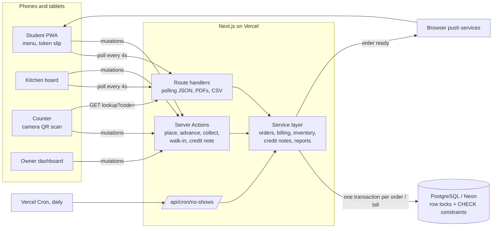
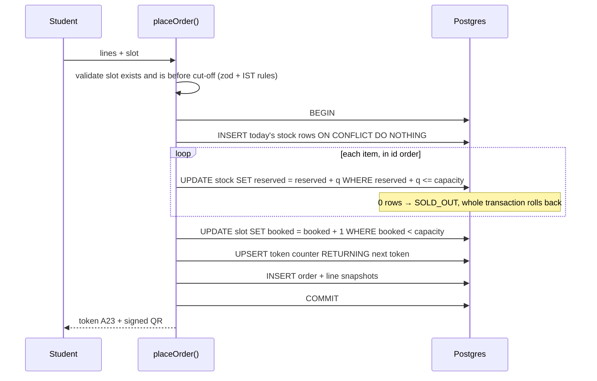

# QueueLess

Pre-order, billing, GST and stock control for college canteens: students order in seconds and pick up with a token, and the canteen gets proper invoices and daily numbers.

**Live demo:** TODO: add the Vercel link after deploying.

## Who is this for and what problem does it solve?

**Students** lose 20+ minutes of a short lunch break standing in the canteen queue, and often reach the counter to find the dish they wanted has sold out.

**Canteen owners and staff** (most college canteens are small contractors) bill on paper. They can't tell which items will run out, they cook food that nobody collects, and they only learn their daily profit or GST totals when someone adds up the slips at month end.

QueueLess fixes both sides:

- A student picks food from a live menu ("only 6 left", "sold out"), chooses a 15-minute pickup slot and gets a short token like **A23** plus a signed QR code. Repeat orders take one tap.
- The kitchen sees orders grouped by pickup slot and marks them Preparing → Ready. The student's phone gets a push notification.
- The counter scans the QR, takes cash or UPI and hands the food over. That moment issues a proper GST invoice (or Bill of Supply) with gap-free numbering.
- The owner sees sales, profit, GST by rate, top and slow items, the real lunch-rush times, no-show rate and wasted food, all exportable to CSV.

## Screenshots

All screenshots use the clearly labelled DEMO canteen from `npm run db:seed`.

| Student menu (phone) | Pickup slots | Token slip |
|---|---|---|
|  |  |  |

| Kitchen board | Counter |
|---|---|
|  |  |

| Owner dashboard | 80 mm thermal invoice |
|---|---|
|  |  |

## Features

**Students**
- Mobile-first menu with veg/non-veg marks, live stock ("only 6 left", "sold out") and favourites.
- "Reorder usual" puts the last order back in the tray in one tap.
- Pickup slots fill up like meters. Full slots are disabled, and ordering closes N minutes before a slot starts.
- Pay at the counter by cash or UPI (a UPI deep link with the exact amount is on the token slip).
- Short daily token (A1…A99, B1…) and an HMAC-signed QR pickup code.
- Live status (Placed → Preparing → Ready → Collected) plus a web push "Your order A23 is ready" (installable PWA).

**Kitchen**
- Board grouped by pickup slot, oldest first. Tap to move Preparing → Ready.
- "PAY FIRST" stamp on orders from students with repeated no-shows. The kitchen can't start these until they're paid.
- Kitchen staff can mark an item out of stock instantly without the owner.

**Counter**
- Scan the QR with the phone camera, or type the token.
- Confirm cash or UPI and hand over, which finalises the invoice.
- Walk-in billing, with an optional buyer name and GSTIN (inter-state buyer → IGST).
- Invoice PDFs in A4 and 80 mm thermal layouts, with GST breakdown by rate, amount in words and a UPI QR.

**Owner**
- Canteen setup: GST registration with a GSTIN checksum check, state, invoice prefix, logo, hours, open days, slot length, kitchen capacity per slot, order cut-off, no-show rules, UPI ID.
- Menu: photo, category, veg/non-veg, price inclusive or exclusive of GST, GST rate per item, HSN/SAC, cost price, daily quantity, prep time, instant availability toggle, and CSV import with a per-line error report.
- Suggested quantity for tomorrow (average of the last 4 same weekdays + 10%).
- Credit notes against an invoice, partial or full. Stock goes back only if the food was never started and it's still the same day.
- Reports: daily sales and profit, GST by rate for the month, top and slow items, peak-slot heatmap, no-show rate, wasted items, and CSV export of each.
- Staff accounts for counter and kitchen.
- Usage tracking: a count of key actions per canteen, with no personal data beyond an internal user id (`npm run stats`).

**Roles** (enforced in every server action and API route, not just hidden in the UI)

| | Student | Kitchen | Counter | Owner |
|---|:-:|:-:|:-:|:-:|
| Place / cancel own order | ✓ | | | |
| Kitchen board, advance orders | | ✓ | view | ✓ |
| Mark item out of stock | | ✓ | | ✓ |
| Scan, take payment, hand over, walk-in billing | | | ✓ | ✓ |
| Edit menu, prices, canteen settings, staff | | | | ✓ |
| Credit notes (cancel / refund an invoice) | | | | ✓ |
| Reports | | | | ✓ |

> **GST disclaimer:** GST rates, HSN/SAC codes and rules change. The rate is editable per item and is never hard-coded. Restaurant-style supply in a canteen is commonly taxed at 5% (SAC 996331), but rates for packaged goods differ. The demo's 18% "Bottled Soda" only exists to show multi-rate bills. Always verify rates against the current official CBIC/GST Council schedule, or ask a chartered accountant, before using this for real billing.

## Tech stack

- **Next.js 16** (App Router, Server Actions, Route Handlers) + **TypeScript** (strict)
- **Tailwind CSS v4** with custom design tokens; Archivo via `next/font`
- **PostgreSQL** on Neon + **Prisma 7** (driver adapter `@prisma/adapter-pg`) with SQL migrations and CHECK constraints
- **zod** for validating every input on the server
- **bcryptjs** passwords, httpOnly session cookies (hashed session ids in the DB)
- **pdf-lib** (invoice PDFs), **qrcode** (QR generation), **jsQR** (camera QR scanning in the browser)
- **web-push** with VAPID keys + a service worker for "order ready" notifications
- **Vitest** for unit and real-Postgres concurrency tests
- Vercel (hosting + daily cron), Neon (database)

## Architecture



**Placing an order (one transaction):**



## Design decisions

1. **Conditional `UPDATE` instead of read-then-write for stock and slots.**
   `UPDATE … SET reserved = reserved + q WHERE reserved + q <= capacity` takes the row lock and re-checks the condition after it gets it. When 50 students race for the last 10 samosas, they queue on that one row and the 11th sees zero rows updated. *Alternatives:* `SELECT … FOR UPDATE` then update (two round trips, same effect), SERIALIZABLE isolation (correct, but needs retry loops and fails more under load), Redis counters (another service and two sources of truth). A database CHECK (`reserved <= capacity`) backs this up in case of an application bug. Items are locked in id order so two multi-item orders can't deadlock.

2. **Gap-free invoice numbers from a counter row, not a Postgres `SEQUENCE`.**
   GST expects consecutive invoice numbers per financial year. Sequences never roll back, so a failed transaction would leave a hole. QueueLess increments a `DocCounter(canteen, series, FY)` row with `INSERT … ON CONFLICT DO UPDATE … RETURNING` inside the same transaction that writes the invoice: a rollback returns the number. Invoices are issued only at payment or hand-over, so cancelled and no-show orders never use a number. *Trade-off:* billing at two counters is serialised on that row for a few milliseconds. That's irrelevant at canteen scale and is exactly what makes it correct.

3. **Polling instead of WebSockets.**
   Vercel's serverless functions can't hold long-lived WebSocket connections. The token slip, kitchen board and counter queue poll small `no-store` JSON endpoints every 4 s, pause when the tab is hidden and back off on errors. *Alternatives:* a hosted realtime service (Pusher/Ably/Supabase Realtime: another vendor and more keys), Server-Sent Events (still bounded by function timeouts), or a separate Node server on Render (more to deploy). *Trade-off:* up to 4 s of latency and some wasted requests. The push notification covers the one moment where latency really matters.

4. **Money as integer paise, and GST computed per line with exact inclusive back-calculation.**
   No floats anywhere. For GST-inclusive prices the taxable value is derived so that taxable + CGST + SGST equals exactly the price on the menu, and CGST always equals SGST. The bill total is rounded to the nearest rupee with an explicit round-off line. A test sweeps thousands of price and rate combinations to prove there's no paisa drift.

5. **No-shows computed when read, and made permanent by a daily cron.**
   Every read applies `effectiveStatus()` (overdue = slot end + grace), so the UI is right even if the cron never ran. The protected cron route marks no-shows, gives back stock for unpaid orders the kitchen never started, and clears expired sessions. Students over the no-show threshold get `requiresPrepay`, and the kitchen is blocked server-side from starting their order until it's paid.

Other choices: the service layer takes an explicit `Actor` (user, role, canteen) instead of reading cookies, so the same functions are tested directly against Postgres. Images live in Postgres (≤400 KB) because Vercel has no persistent disk. Items are archived, never deleted, because invoices reference them.

## How to run locally

Prerequisites: Node 20+ and a Postgres database (a free Neon project works).

```bash
npm install
cp .env.example .env          # fill in DATABASE_URL, QR_SECRET, CRON_SECRET, DEMO_PASSWORD
npm run vapid                 # optional: paste the keys into .env for push notifications
npm run db:deploy             # apply migrations
npm run db:seed               # optional: DEMO canteen, menu, staff and 3 weeks of demo orders
npm run dev                   # http://localhost:3000
```

Without the seed, the first visit opens `/setup`, where you create the canteen and the owner account.

Demo logins (after seeding, password = `DEMO_PASSWORD`): `owner@demo.queueless.in`, `counter@demo.queueless.in`, `kitchen@demo.queueless.in`, `student@demo.queueless.in`.

Checks:

```bash
npm test          # unit tests + real-Postgres concurrency tests
npm run lint
npm run typecheck
npm run build
npm run stats     # honest usage numbers ("Used by N students")
```

The integration tests use `TEST_DATABASE_URL` if set, otherwise `DATABASE_URL`. Each test file creates its own throwaway "TEST canteen" and deletes it afterwards.

## Deploy

1. **Database:** create a free Neon project and copy the *pooled* connection string.
2. **Migrate (and optionally seed)** from your machine with `DATABASE_URL` pointing at Neon: `npm run db:deploy` (then `npm run db:seed` for the demo).
3. **Vercel:** import the GitHub repo (framework preset Next.js, default build command).
4. Add these environment variables in Vercel → Settings → Environment Variables:

| Variable | Required | Notes |
|---|---|---|
| `DATABASE_URL` | yes | Neon pooled URL with `sslmode=require` |
| `QR_SECRET` | yes | 32+ random chars |
| `CRON_SECRET` | yes | 16+ random chars. Vercel Cron sends it as a Bearer token |
| `NEXT_PUBLIC_VAPID_PUBLIC_KEY`, `VAPID_PRIVATE_KEY`, `VAPID_SUBJECT` | for push | from `npm run vapid`; subject like `mailto:you@college.edu` |
| `DEMO_PASSWORD` | only for the demo | shown on the landing page while the demo canteen is active |

5. Deploy. `vercel.json` schedules `/api/cron/no-shows` daily at 00:00 IST (18:30 UTC). That fits the Hobby plan's one-run-per-day limit.
6. Open the site on a phone and use "Add to Home Screen" to test push (iOS requires the installed PWA).

TODO: paste the live URL at the top of this README.

## Limitations and what breaks at scale

- **One canteen per deployment.** The schema has `canteenId` everywhere, but sign-up attaches students to the first canteen. A multi-canteen campus needs a canteen picker and per-canteen staff invites.
- **Polling cost.** 500 students with the token slip open is ~125 requests per second at a 4 s interval. That's fine for one canteen on Vercel and Neon free tiers. A whole university would want SSE or a realtime service, plus ETags to skip unchanged payloads.
- **Hot rows.** Every order for a popular item updates the same `DailyStock` row, and every bill takes the same `DocCounter` row. Postgres handles hundreds of these per second, which is far beyond a canteen. A national chain would shard counters per counter or terminal (still gap-free per series).
- **Payment is at the counter only.** No online payment yet, so a reservation isn't money: the no-show rules and prepay flag are the mitigation. Online UPI collection (Razorpay/Cashfree with a webhook marking the order paid and issuing the invoice) is the documented next step.
- **GST scope.** Handles B2C and simple B2B invoices, CGST+SGST vs IGST, multi-rate bills, rounding and Bills of Supply. It doesn't do e-invoicing (IRN/QR from the IRP), e-way bills, cess, reverse charge or GSTR filing. A real deployment must verify rates with a CA.
- **PDF fonts.** Invoices use the standard PDF fonts, so names in Tamil/Hindi script and the ₹ sign are printed in Latin form ("Rs."). Embedding a Unicode font fixes this at the cost of a larger bundle.
- **Images in Postgres.** Fine for a few dozen menu photos. Many large images belong in object storage (S3/R2).
- **Device testing.** Camera QR scanning, real push delivery and the slide-to-hand-over gesture were built for phones but only tested in desktop and headless Chrome. They still need a pass on a real Android phone and an iPhone (installed as a PWA).
- **Login rate limiting** is only bcrypt's cost. There is no per-IP lockout yet.
- **Polling, not push, on the kitchen board.** If the kitchen tablet loses Wi-Fi, it shows a reconnecting state but can't buffer actions offline.

## What I learned

- Correctness under concurrency comes from where you put the check. A conditional `UPDATE` and a CHECK constraint did more than any amount of application-level locking, and a test that fires 50 real parallel transactions was the only thing that convinced me.
- "Gap-free" and "sequence" are different things: Postgres sequences are deliberately non-transactional. Using a counter row inside the transaction is simpler and actually correct.
- GST-inclusive pricing is tricky. Computing tax forwards from a back-calculated taxable value drifts by a paisa. Deriving taxable as *price − tax* keeps the bill equal to the menu.
- Designing for the kitchen (read from 2 m away, greasy hands, noisy room) is a different problem from designing for a student's phone. Big type and tap-anywhere targets mattered more than visual detail.

## What I'd improve next

- Online UPI payment with webhooks, so pre-orders are paid at order time and no-shows cost the student, not the canteen.
- Server-Sent Events with ETags for the kitchen board, to cut polling traffic and latency.
- E-invoicing (IRN) support and a GSTR-1-ready export for canteens above the e-invoice threshold.

## Repository details

**About (GitHub description):** Pre-ordering, GST billing, stock and reports for college canteens. Students skip the lunch queue and canteens get gap-free invoices. Next.js + Postgres.

**Topics:** `nextjs`, `postgresql`, `gst-invoice`, `canteen-management`, `pwa`
